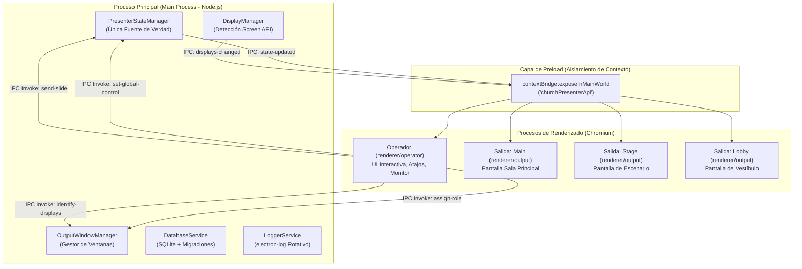
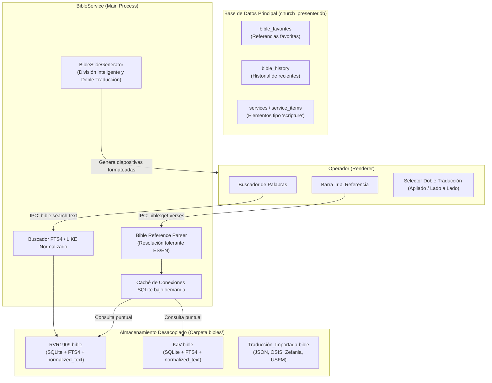
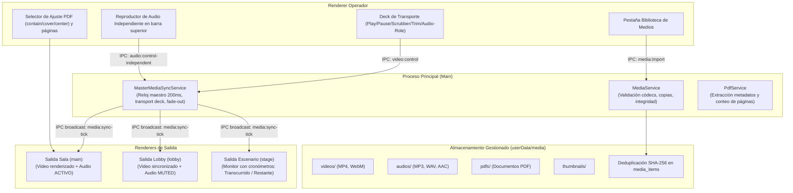
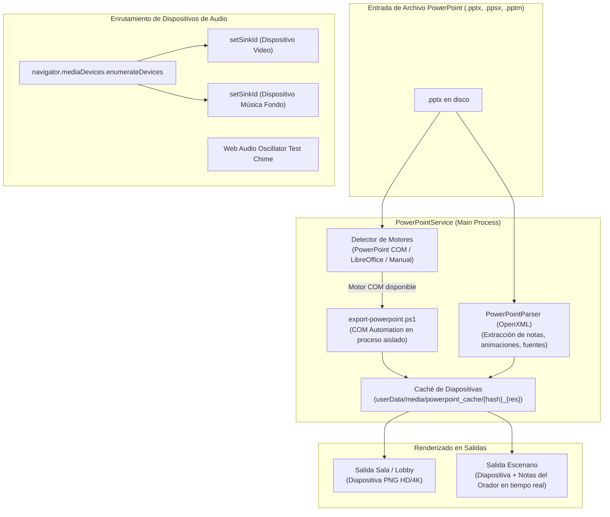
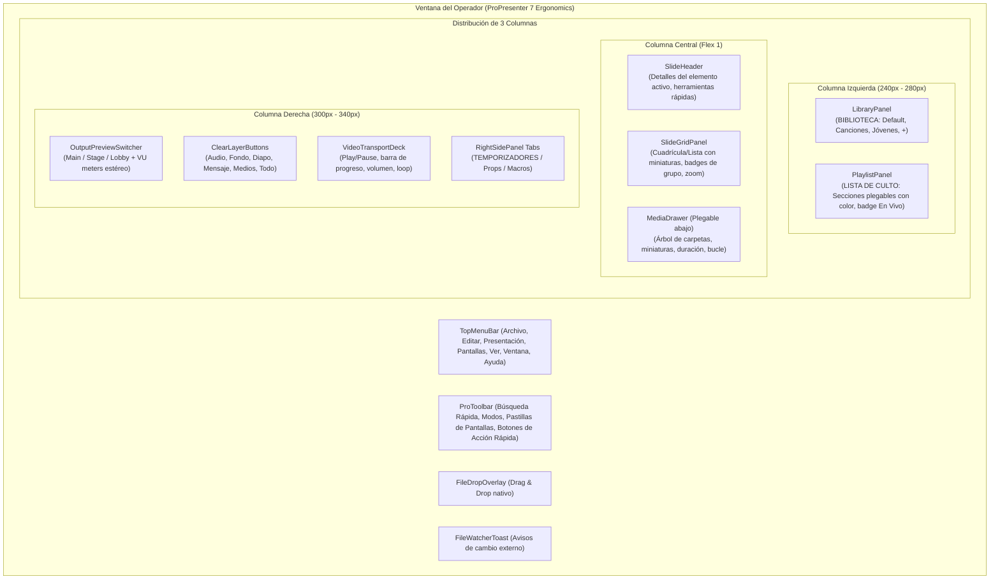
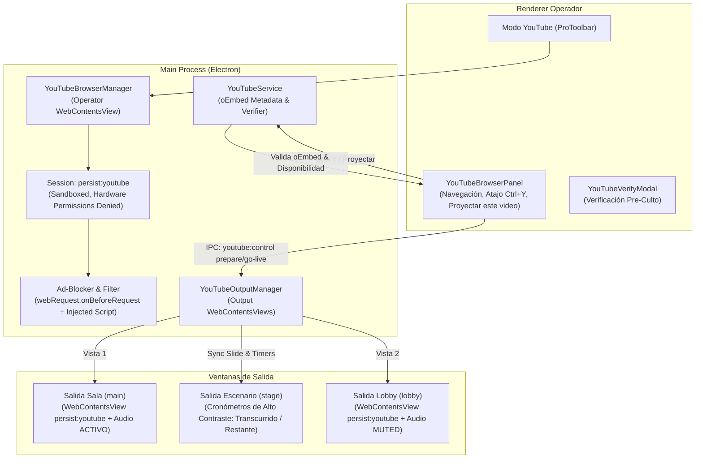
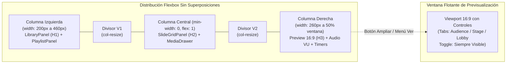

# ChurchPresenter - Arquitectura del Sistema

Este documento describe la arquitectura técnica de **ChurchPresenter**, el flujo de estado, la interacción entre procesos de Electron y el modelo de ventanas y capas multipantalla.

---

## 1. Arquitectura de Procesos



---

## 2. Flujo de Estado Unidireccional (Single Source of Truth)

Toda mutación de estado nace en el proceso principal. Los renderizadores nunca mutan el estado directamente; envían intenciones/acciones mediante invocaciones IPC tipadas y reciben snapshots inmutables del estado actualizado.

```
[Acción del Operador] (p. ej. Presionar 'Negro' o 'F1')
       │
       ▼
[IPC Invoke: 'control:set-global']
       │
       ▼
[Main Process: PresenterStateManager]
       ├── 1. Valida y aplica la mutación en el estado inmutable
       ├── 2. Persiste la configuración relevante en SQLite (si aplica)
       ├── 3. Registra la acción en el archivo de log rotativo
       │
       ▼
[Broadcast IPC: 'state:updated'] (a todas las ventanas activas)
       ├──> Ventana Operador (actualiza botón Negro a estado activo/brillante)
       ├──> Ventana Output 'main' (aplica opacidad 0 o capa negra instantánea)
       ├──> Ventana Output 'stage' (refleja estado según configuración de capas)
       └──> Ventana Output 'lobby' (aplica capa negra)
```

---

## 3. Modelo de Ventanas y Robustez

1. **Ventana del Operador (`operator`)**:
   - Ventana estándar con marco, minimizable, redimensionable, con acceso al control total y vista previa de pantallas.
2. **Ventanas de Salida (`output/:role`)**:
   - Una ventana independiente por cada rol físico asignado (`main`, `stage`, `lobby`, etc.).
   - Atributos clave:
     - `frame: false` (sin bordes).
     - `fullscreen: false` con bounds exactos `(x, y, width, height)` de la pantalla destino (técnica preferida en Windows multipantalla para evitar desubicación de coordenadas al perder foco).
     - `alwaysOnTop: true` (nivel 'screen-saver' o 'floating' configurable).
     - `skipTaskbar: true` (evita saturar la barra de tareas y el diálogo Alt+Tab de Windows).
     - `cursor: none` (cursor oculto permanentemente sobre la superficie de proyección).
     - `backgroundColor: '#000000'` (fondo negro para evitar parpadeos blancos durante la carga).
3. **Resiliencia y Auto-Recuperación**:
   - El `OutputWindowManager` escucha el evento `render-process-gone` y `unresponsive`.
   - Si una ventana de salida falla o es cerrada accidentalmente por el sistema operativo, se registra el incidente con severidad `ERROR` y se instancia una nueva ventana en la misma pantalla en menos de 1 segundo sin afectar al resto de salidas.

---

## 4. Arquitectura de Capas de Salida

Cada rol de salida renderiza cuatro capas apiladas con orden z-index definido:

```
┌────────────────────────────────────────────────────────┐
│ Capa 4: Mensaje (Message Layer - z-index: 40)          │  <-- Avisos urgentes, guardería, alertas
├────────────────────────────────────────────────────────┤
│ Capa 3: Superpuesto (Overlay Layer - z-index: 30)      │  <-- Logo, lower-thirds, marcas de agua
├────────────────────────────────────────────────────────┤
│ Capa 2: Contenido (Content Layer - z-index: 20)        │  <-- Letra de canciones, diapositivas, Biblia
├────────────────────────────────────────────────────────┤
│ Capa 1: Fondo (Background Layer - z-index: 10)         │  <-- Color sólido, degradado, video o imagen
└────────────────────────────────────────────────────────┘
```

### Controles Globales de Supresión Rápida
- **Negro (Black)**: Suprime todas las capas inmediatamente (renderiza negro absoluto en pantalla).
- **Limpiar (Clear)**: Oculta la Capa 2 (Contenido) y Capa 4 (Mensaje), manteniendo visible la Capa 1 (Fondo).
- **Logo**: Muestra inmediatamente el logo configurado en la Capa 3 (Superpuesto), respetando o superponiéndose al fondo.
- **Congelar (Freeze)**: El renderizador de salida ignora temporalmente actualizaciones de contenido nuevo entrantes, congelando el último frame renderizado en memoria GPU hasta descongelar.

---

## 5. Canales IPC Tipados

| Canal IPC | Tipo | Dirección | Descripción |
|---|---|---|---|
| `screens:get` | Invoke/Handle | Renderer -> Main | Solicita lista de pantallas físicas detectadas |
| `screens:identify` | Invoke/Handle | Renderer -> Main | Dispara overlay de identificación durante 3 segundos |
| `screens:assign-role` | Invoke/Handle | Renderer -> Main | Asigna o desasigna un rol a un ID de pantalla |
| `screens:changed` | Send | Main -> Renderer | Notifica conexión/desconexión o cambio de resolución |
| `state:get` | Invoke/Handle | Renderer -> Main | Obtiene el estado actual completo |
| `state:updated` | Send | Main -> Renderer | Notifica mutaciones de estado a todas las ventanas |
| `control:set-global` | Invoke/Handle | Renderer -> Main | Activa/desactiva Black, Clear, Logo, Freeze |
| `slides:send` | Invoke/Handle | Renderer -> Main | Envía una diapositiva a uno o varios roles |
| `stress:log-drop` | Send | Renderer -> Main | Notifica caída de FPS en modo de prueba de estrés al logger |

---

## 6. Panel del Operador en 3 Zonas

El panel principal del operador se organiza en tres zonas de trabajo ergonómicas:

```
┌──────────────────┬───────────────────┬──────────────────────────────────────┐
│  1. BIBLIOTECA   │ 2. LISTA SERVICIO │ 3. DIAPOSITIVAS Y MONITORES DUALES   │
│                  │                   │                                      │
│ [Canciones]      │ Servicio Domingo  │ [EN VIVO]         [VISTA PREVIA]     │
│ [Presentaciones] │ ───────────────── │ Salida Principal  Monitor Previo     │
│                  │ 1. 🎵 Alabanza 1  │ ──────────────────────────────────── │
│ 🔍 Buscar...     │    Arreglo: Def   │ Cuadrícula de diapositivas           │
│                  │ 2. 🎵 Alabanza 2  │ ┌─────────┐ ┌─────────┐ ┌──────────┐ │
│ • Cuán Grande    │ 3. 📄 Bienvenida  │ │Verso 1  │ │Coro     │ │Verso 2   │ │
│ • En la Cruz     │ 4. ➖ En Blanco   │ │(Doble   │ │(Click:  │ │          │ │
│ • Sublime Gracia │                   │ │ Clic)   │ │ Previo) │ │          │ │
│                  │ [▲ Subir] [▼] [X] │ └─────────┘ └─────────┘ └──────────┘ │
│ [+ Nueva Canción]│ [+ Blanco][+ Sep] │ [Actualizar en vivo si fue editada]  │
└──────────────────┴───────────────────┴──────────────────────────────────────┘
```

- **Zona 1 (Biblioteca)**: Búsqueda rápida insensible a acentos y tolerante a faltas ortográficas. Acceso a creación/edición de canciones, importación y exportación de biblioteca en formato JSON.
- **Zona 2 (Lista del Servicio)**: Elementos ordenados del culto (canciones con selector de arreglo, anuncios, diapositivas en blanco y separadores). Permite guardar como plantilla, crear desde plantilla o duplicar cultos.
- **Zona 3 (Diapositivas y Monitores)**:
  - **Doble Monitor Superior**: Muestra en tiempo real lo que está `EN VIVO` en las pantallas de la congregación y la `VISTA PREVIA` de la diapositiva seleccionada antes de proyectarla.
  - **Cuadrícula de Diapositivas**: Un clic selecciona para vista previa; doble clic o tecla `Enter` envía a las pantallas en vivo.
  - **Actualizar en vivo**: Si el operador edita una canción que está siendo proyectada, lo proyectado se mantiene intacto sin parpadeos hasta que el operador presiona el botón "Actualizar en vivo".
  - **Navegación por teclado**: Flechas (Arriba/Abajo/Izquierda/Derecha) navegan diapositivas; `PageDown` o tecla `N` avanza al siguiente elemento de la lista del culto.

---

## 7. Monitor de Escenario (Confidence Monitor)

El rol de salida `stage` implementa una vista adaptada para músicos, cantantes y predicador:

```
┌─────────────────────────────────────────────────────────────────────────────┐
│ [RETORNO / ESCENARIO]            Cuán Grande es Él                 10:45:00 │
├─────────────────────────────────────────────────────────────────────────────┤
│ 🔔 ALERTA DEL OPERADOR: "Baja el volumen del micrófono 2"                   │
├─────────────────────────────────────────┬───────────────────────────────────┤
│ EN PANTALLA (62% ancho)                 │ SIGUIENTE (38% ancho)             │
│                                         │                                   │
│ ¡Cuán grande es Él!                     │ Cuando recuerdo del amor divino   │
│ ¡Cuán grande es Él!                     │ que desde el cielo al Salvador    │
│ Canta mi ser, mi Salvador, a Ti...      │ envió...                          │
│                                         │                                   │
└─────────────────────────────────────────┴───────────────────────────────────┘
```

1. **Reloj de Alta Precisión**: Hora local actualizada cada segundo.
2. **Banner de Mensajes**: Mensajes instantáneos enviados por el operador (ej. avisos de tiempo, guardería o volumen).
3. **Panel Dividido Actual vs Siguiente**: Contraste alto con letra extragrande para la diapositiva en curso y previsualización de la siguiente estrofa para anticipar el canto.

---

## 8. Arquitectura del Motor Bíblico (Fase 4)

El subsistema de la Biblia está diseñado para alto rendimiento, desacoplamiento y cero impacto en el tamaño de la base de datos principal de la aplicación:



1. **Archivos `.bible` Desacoplados**: Cada traducción reside en su propio archivo SQLite en `userData/bibles/`. La base de datos principal jamás almacena los 31.102 versículos, garantizando arranques ultrarrápidos y copias de seguridad de la base principal en milisegundos.
2. **Búsqueda Tolerante de Referencias**: Mapeo canónico de los 66 libros con soporte para español e inglés, números romanos ("I Juan" -> "1 Juan"), abreviaturas comunes ("jn", "1 co", "sal", "gén"), rangos entre capítulos y versículos ("Juan 3:16-17", "Génesis 1:1-2:3") y capítulos completos ("Salmos 23").
3. **Búsqueda Eficiente de Palabras**: Motor híbrido que aprovecha FTS4 para palabras completas y consultas sobre la columna pre-normalizada sin acentos (`normalized_text`), logrando tiempos de respuesta de menos de 1 ms sobre toda la Biblia.
4. **Doble Traducción Simultánea**: Permite proyectar dos versiones a la vez (por ejemplo RVR1909 y KJV) en modo apilado o lado a lado, con tamaños de letra adaptativos (auto-fit).
5. **Persistencia en el Culto**: Los pasajes bíblicos se pueden enviar a vivo directamente desde la pestaña de Biblia o guardarse en la lista del servicio activo como elementos de tipo `'scripture'`.

---

## 9. Arquitectura del Módulo de Medios y Presentaciones PDF (Fase 5A)



### Características Principales de Medios y PDF
1. **Deduplicación SHA-256**: Ningún archivo multimedia se almacena dos veces; si se detecta un hash repetido, se reutiliza el identificador existente.
2. **Reloj Maestro de Sincronización**: El proceso principal transmite pulsos de tiempo (`mediaSyncTick`) cada 200 ms. Las salidas ajustan automáticamente el tiempo solo si la deriva supera los 150 ms, evitando microtirones de audio y video.
3. **Enrutamiento Inteligente de Audio**: Solo la salida designada (`audioOutputRole`, por defecto `main`) reproduce audio por hardware; las salidas secundarias reproducen en silencio para evitar eco acústico.
4. **Pantalla de Escenario Especializada**: Durante la reproducción de video, el monitor de escenario presenta números gigantes de alto contraste indicando el tiempo transcurrido (`01:23`) y el tiempo restante (`-02:15`).
5. **Renderizado Vectorial de PDF**: Integración de `pdfjs-dist` con escalado DPR dinámico, soporte para encajar completo (`contain`), rellenar (`cover`) o centrar (`center`), y precarga en segundo plano de páginas adyacentes para una navegación sin pausas.
6. **Música Independiente de Entrada/Fondo**: Reproductor de pista de audio de fondo en la barra superior con controles de pausa, reanudación y botón de fundido de salida suave de 3 segundos (`fade-out`).
7. **Fondos de Video en Bucle**: Soporte para temas con fondos de video animados en bucle continuo y silenciado.

---

## 10. Arquitectura de Integración de PowerPoint y Conversión de Medios (Fase 5B)



### Características Principales de PowerPoint
1. **Automatización COM Aislada**: El script `export-powerpoint.ps1` se ejecuta mediante PowerShell con políticas seguras (`-ExecutionPolicy Bypass`, `-NoProfile`, `-NonInteractive`), sin macros (`AutomationSecurity = 3`), sin ventana visible (`WithWindow: false`) y sin interferir con instancias existentes de PowerPoint abiertas por el usuario.
2. **Extracción Directa de Notas del Orador**: `PowerPointParser` lee directamente los archivos XML (`ppt/notesSlides/notesSlide*.xml`) del paquete comprimido `.pptx` y asocia cada nota a su diapositiva respectiva, proyectándola con tipografía clara en el monitor de escenario.
3. **Análisis de Fidelidad**: Avisa preventivamente al operador si una diapositiva contiene animaciones (que se proyectarán estáticas), transiciones o fuentes tipográficas ausentes en Windows.
4. **Caché Determinista por Resolución y Hash**: Evita re-exportaciones redundantes de presentaciones ya procesadas.
5. **Detección de Modificaciones y Apertura Externa**: Permite abrir la presentación en PowerPoint nativo para edición y detectar cambios externos por hash para reimportar en caliente con un clic.

---

## 11. Arquitectura del Rediseño de Interfaz del Operador (Inspirada en ProPresenter 7)

Para reducir la curva de aprendizaje del equipo de audiovisuales de la iglesia y mantener un flujo de trabajo fluido y familiar, la ventana del operador se rediseñó modularmente en React siguiendo la ergonomía y densidad visual de ProPresenter 7:



### Componentes Modulares del Operador:
1. **TopMenuBar**: Barra superior oscura compacta con menús desplegables estándar de Windows y atajos de teclado asociados.
2. **ProToolbar**: Barra de herramientas con campo de búsqueda rápida (`Ctrl+K`), selector de modos (Mostrar, Editar, Biblia, Ajustes), indicadores activos de pantallas (Medios, Audiencia, Escenario) y botones de acción rápida inmediatos (Negro, Limpiar, Logo, Congelar).
3. **LibraryPanel**: Gestión de colecciones/librerías de usuario almacenadas en SQLite (`user_libraries`), permitiendo organizar elementos por ministerios o cultos y arrastrarlos directamente al servicio.
4. **PlaylistPanel**: Selector de servicios con cabeceras de sección con color configurable (p. ej., "MÚSICA", "MENSAJE", "ANUNCIOS"), reordenamiento drag-and-drop, conteo de diapositivas y distintivo "EN VIVO" en el elemento proyectado.
5. **SlideGridPanel**: Visor central de diapositivas con miniaturas de alta legibilidad, distintivos coloreados por grupo litúrgico (Verso 1, Coro, etc.), números de diapositiva ordenados, control deslizante de zoom y alternancia entre vista en cuadrícula y vista de lista.
6. **MediaDrawer**: Cajón inferior colapsable tipo ProPresenter para examinar medios de fondo y videos con árbol de carpetas, distintivos de duración y bucle, y control de zoom.
7. **RightSidePanel**:
   - **Previsualizador de Salida**: Selector de pantalla activa (`main`, `stage`, `lobby`) con vúmetros animados en verde/amarillo/rojo.
   - **Botones de Limpieza por Capas**: Acceso rápido para limpiar selectivamente `Audio`, `Fondo`, `Diapo`, `Mensaje`, `Medios` o `Todo`.
   - **Deck de Transporte de Video**: Reproducción sincronizada con reloj maestro.
   - **Pestaña de Temporizadores Activa**: Cuenta regresiva por duración (`MM:SS`), cuenta hacia una hora del día (`HH:MM`) y cronómetro progresivo con botones de Iniciar/Pausa/Reiniciar y opción de visibilidad en audiencia o escenario.
   - **Pestañas Props y Macros**: Deshabilitadas con distintivo "Próximamente" sin afectar el flujo del operador.
8. **FileDropOverlay**: Arrastrar y soltar nativo de archivos (PPTX, PDF, videos, imágenes) sobre la interfaz usando `webUtils.getPathForFile()`.
9. **FileWatcherToast**: Notificación discreta de auto-recarga cuando un archivo PPTX o de medios externo es modificado en disco, con botón "Actualizar" que preserva la posición del servicio.

---

## 12. Arquitectura de Integración de YouTube (Fase 5C)



### Características de la Integración de YouTube:
1. **Aislamiento de Sesión y Persistencia**: Usa la partición de sesión dedicada `persist:youtube`. Las cookies, inicio de sesión (Google / YouTube Premium) y preferencias del usuario se almacenan en el perfil de datos local de manera segura y persistente. La aplicación jamás intercepta ni lee contraseñas.
2. **Navegación Restringida a Dominios Esenciales**: Bloqueo estricto de navegación a cualquier dominio externo a `youtube.com`, `google.com`, `accounts.google.com`, `gstatic.com`, `ytimg.com`, `googlevideo.com` y `googleusercontent.com`. Enlaces externos se derivan automáticamente al navegador del sistema operativo.
3. **Reproducción por Vistas Nativas sin Parpadeo (Opción b)**: En lugar de un iframe con almacenamiento particionado, las salidas utilizan vistas `WebContentsView` asociadas a `persist:youtube`. Durante la preparación se precargan en pausa y con visibilidad oculta; al pulsar "En vivo", se activan al instante sin recarga ni parpadeo.
4. **Enrutamiento de Audio Exclusivo**: El audio se emite exclusivamente por el rol de salida asignado (por defecto Sala), silenciando por hardware las pantallas accesorias.
5. **Verificación Pre-Culto de la Lista**: El operador dispone del botón "Verificar playlist", que comprueba en lote el estado de disponibilidad e incrustabilidad de todos los videos de YouTube del servicio antes del inicio de la reunión.
6. **Integración con Emergencias y Monitor de Escenario**: Los controles de Negro (F1), Limpiar (F2) y Congelar (F4) actúan directamente sobre la reproducción de YouTube, y el monitor de escenario presenta el título y los cronómetros de tiempo transcurrido y restante.

---

## 13. Arquitectura del Layout Flexible y Estilo Visual del Operador (v1.1)



### Principios de Maquetación y Sistema de Paneles:
1. **Contenedor Flexbox con Espacio Propio y `min-width: 0`**:
   - Cada columna (`.pro-left-column`, `.pro-center-column`, `.pro-right-panel`) cuenta con `min-width: 0`, `min-height: 0` y overflow controlado.
   - Se eliminaron posiciones absolutas o anchos fijos que antes provocaban que la columna izquierda se superpusiera sobre la zona central (evitando el corte visual "RELUDIO..." o "EPARADOR").
   - Los títulos largos se truncan limpiamente con `text-overflow: ellipsis` al final y muestran el texto completo en tooltip mediante el atributo `title`.
2. **Divisores Redimensionables y Persistencia**:
   - Divisores verticales `V1` (entre Izquierda y Centro) y `V2` (entre Centro y Derecha, permitiendo extender la columna derecha hasta el 50% del ancho de la ventana).
   - Divisores horizontales `H1` (entre Library y Playlist), `H2` (entre diapositivas y cajón de medios) y `H3` (entre previsualizador y temporizadores).
   - Doble clic en cualquier divisor restaura su tamaño estándar.
   - Las dimensiones se guardan en `localStorage` y se restauran al iniciar la aplicación. Opción en Menú Ver: "Restablecer diseño".
3. **Previsualizador Escalar y Ventana Flotante Independiente**:
   - La previsualización de la columna derecha escala de forma fluida conservando la relación de aspecto 16:9.
   - Botón "Ampliar" que abre una ventana flotante redimensionable (`/floating-preview`) con selector de rol (`Audience`, `Stage`, `Lobby`) y botón "Siempre visible".
   - **Aislamiento de Pantallas de Proyección**: La ventana flotante es estrictamente un monitor auxiliar para el operador y no se registra en `DisplayManager`, por lo que nunca aparece en la lista de pantallas ni compite por asignaciones de salida.
4. **Paleta Oscura Profesional con Variables CSS y Contraste WCAG AA**:
   - Reemplazo de tonos azul marino por fondos oscuros neutros (`--bg-base: #0A0A0A`, `--bg-surface: #121212`, `--bg-surface-raised: #181818`, `--border-color: #2A2A2A`).
   - Colores de acento configurables en Configuración -> Apariencia: Primario (`#FF7A00`), En Vivo (`#22C55E`), Vista Previa (`#2D9CFF`), Peligro (`#EF4444`).
   - Controles nativos (`select`, `input`, `button`, barras de desplazamiento delgadas, `checkbox`, `range`) estilizados bajo el tema oscuro sin fondos blancos del sistema.


