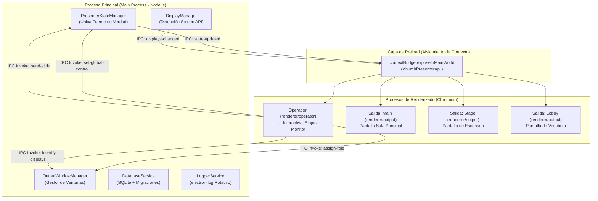

# ChurchPresenter - Arquitectura del Sistema

Este documento describe la arquitectura técnica de **ChurchPresenter**, el flujo de estado, la interacción entre procesos de Electron y el modelo de ventanas y capas multipantalla.

---

## 1. Arquitectura de Procesos



---

## 2. Flujo de Estado Unidireccional (Single Source of Truth)

Toda mutación de estado nace en el proceso principal. Los renderizadores nunca mutan el estado directamente; envían intenciones/acciones mediante invocaciones IPC tipadas y reciben snapshots inmutables del estado actualizado.

```
[Acción del Operador] (p. ej. Presionar 'Negro' o 'F1')
       │
       ▼
[IPC Invoke: 'control:set-global']
       │
       ▼
[Main Process: PresenterStateManager]
       ├── 1. Valida y aplica la mutación en el estado inmutable
       ├── 2. Persiste la configuración relevante en SQLite (si aplica)
       ├── 3. Registra la acción en el archivo de log rotativo
       │
       ▼
[Broadcast IPC: 'state:updated'] (a todas las ventanas activas)
       ├──> Ventana Operador (actualiza botón Negro a estado activo/brillante)
       ├──> Ventana Output 'main' (aplica opacidad 0 o capa negra instantánea)
       ├──> Ventana Output 'stage' (refleja estado según configuración de capas)
       └──> Ventana Output 'lobby' (aplica capa negra)
```

---

## 3. Modelo de Ventanas y Robustez

1. **Ventana del Operador (`operator`)**:
   - Ventana estándar con marco, minimizable, redimensionable, con acceso al control total y vista previa de pantallas.
2. **Ventanas de Salida (`output/:role`)**:
   - Una ventana independiente por cada rol físico asignado (`main`, `stage`, `lobby`, etc.).
   - Atributos clave:
     - `frame: false` (sin bordes).
     - `fullscreen: false` con bounds exactos `(x, y, width, height)` de la pantalla destino (técnica preferida en Windows multipantalla para evitar desubicación de coordenadas al perder foco).
     - `alwaysOnTop: true` (nivel 'screen-saver' o 'floating' configurable).
     - `skipTaskbar: true` (evita saturar la barra de tareas y el diálogo Alt+Tab de Windows).
     - `cursor: none` (cursor oculto permanentemente sobre la superficie de proyección).
     - `backgroundColor: '#000000'` (fondo negro para evitar parpadeos blancos durante la carga).
3. **Resiliencia y Auto-Recuperación**:
   - El `OutputWindowManager` escucha el evento `render-process-gone` y `unresponsive`.
   - Si una ventana de salida falla o es cerrada accidentalmente por el sistema operativo, se registra el incidente con severidad `ERROR` y se instancia una nueva ventana en la misma pantalla en menos de 1 segundo sin afectar al resto de salidas.

---

## 4. Arquitectura de Capas de Salida

Cada rol de salida renderiza cuatro capas apiladas con orden z-index definido:

```
┌────────────────────────────────────────────────────────┐
│ Capa 4: Mensaje (Message Layer - z-index: 40)          │  <-- Avisos urgentes, guardería, alertas
├────────────────────────────────────────────────────────┤
│ Capa 3: Superpuesto (Overlay Layer - z-index: 30)      │  <-- Logo, lower-thirds, marcas de agua
├────────────────────────────────────────────────────────┤
│ Capa 2: Contenido (Content Layer - z-index: 20)        │  <-- Letra de canciones, diapositivas, Biblia
├────────────────────────────────────────────────────────┤
│ Capa 1: Fondo (Background Layer - z-index: 10)         │  <-- Color sólido, degradado, video o imagen
└────────────────────────────────────────────────────────┘
```

### Controles Globales de Supresión Rápida
- **Negro (Black)**: Suprime todas las capas inmediatamente (renderiza negro absoluto en pantalla).
- **Limpiar (Clear)**: Oculta la Capa 2 (Contenido) y Capa 4 (Mensaje), manteniendo visible la Capa 1 (Fondo).
- **Logo**: Muestra inmediatamente el logo configurado en la Capa 3 (Superpuesto), respetando o superponiéndose al fondo.
- **Congelar (Freeze)**: El renderizador de salida ignora temporalmente actualizaciones de contenido nuevo entrantes, congelando el último frame renderizado en memoria GPU hasta descongelar.

---

## 5. Canales IPC Tipados

| Canal IPC | Tipo | Dirección | Descripción |
|---|---|---|---|
| `screens:get` | Invoke/Handle | Renderer -> Main | Solicita lista de pantallas físicas detectadas |
| `screens:identify` | Invoke/Handle | Renderer -> Main | Dispara overlay de identificación durante 3 segundos |
| `screens:assign-role` | Invoke/Handle | Renderer -> Main | Asigna o desasigna un rol a un ID de pantalla |
| `screens:changed` | Send | Main -> Renderer | Notifica conexión/desconexión o cambio de resolución |
| `state:get` | Invoke/Handle | Renderer -> Main | Obtiene el estado actual completo |
| `state:updated` | Send | Main -> Renderer | Notifica mutaciones de estado a todas las ventanas |
| `control:set-global` | Invoke/Handle | Renderer -> Main | Activa/desactiva Black, Clear, Logo, Freeze |
| `slides:send` | Invoke/Handle | Renderer -> Main | Envía una diapositiva a uno o varios roles |
| `stress:log-drop` | Send | Renderer -> Main | Notifica caída de FPS en modo de prueba de estrés al logger |

---

## 6. Panel del Operador en 3 Zonas

El panel principal del operador se organiza en tres zonas de trabajo ergonómicas:

```
┌──────────────────┬───────────────────┬──────────────────────────────────────┐
│  1. BIBLIOTECA   │ 2. LISTA SERVICIO │ 3. DIAPOSITIVAS Y MONITORES DUALES   │
│                  │                   │                                      │
│ [Canciones]      │ Servicio Domingo  │ [EN VIVO]         [VISTA PREVIA]     │
│ [Presentaciones] │ ───────────────── │ Salida Principal  Monitor Previo     │
│                  │ 1. 🎵 Alabanza 1  │ ──────────────────────────────────── │
│ 🔍 Buscar...     │    Arreglo: Def   │ Cuadrícula de diapositivas           │
│                  │ 2. 🎵 Alabanza 2  │ ┌─────────┐ ┌─────────┐ ┌──────────┐ │
│ • Cuán Grande    │ 3. 📄 Bienvenida  │ │Verso 1  │ │Coro     │ │Verso 2   │ │
│ • En la Cruz     │ 4. ➖ En Blanco   │ │(Doble   │ │(Click:  │ │          │ │
│ • Sublime Gracia │                   │ │ Clic)   │ │ Previo) │ │          │ │
│                  │ [▲ Subir] [▼] [X] │ └─────────┘ └─────────┘ └──────────┘ │
│ [+ Nueva Canción]│ [+ Blanco][+ Sep] │ [Actualizar en vivo si fue editada]  │
└──────────────────┴───────────────────┴──────────────────────────────────────┘
```

- **Zona 1 (Biblioteca)**: Búsqueda rápida insensible a acentos y tolerante a faltas ortográficas. Acceso a creación/edición de canciones, importación y exportación de biblioteca en formato JSON.
- **Zona 2 (Lista del Servicio)**: Elementos ordenados del culto (canciones con selector de arreglo, anuncios, diapositivas en blanco y separadores). Permite guardar como plantilla, crear desde plantilla o duplicar cultos.
- **Zona 3 (Diapositivas y Monitores)**:
  - **Doble Monitor Superior**: Muestra en tiempo real lo que está `EN VIVO` en las pantallas de la congregación y la `VISTA PREVIA` de la diapositiva seleccionada antes de proyectarla.
  - **Cuadrícula de Diapositivas**: Un clic selecciona para vista previa; doble clic o tecla `Enter` envía a las pantallas en vivo.
  - **Actualizar en vivo**: Si el operador edita una canción que está siendo proyectada, lo proyectado se mantiene intacto sin parpadeos hasta que el operador presiona el botón "Actualizar en vivo".
  - **Navegación por teclado**: Flechas (Arriba/Abajo/Izquierda/Derecha) navegan diapositivas; `PageDown` o tecla `N` avanza al siguiente elemento de la lista del culto.

---

## 7. Monitor de Escenario (Confidence Monitor)

El rol de salida `stage` implementa una vista adaptada para músicos, cantantes y predicador:

```
┌─────────────────────────────────────────────────────────────────────────────┐
│ [RETORNO / ESCENARIO]            Cuán Grande es Él                 10:45:00 │
├─────────────────────────────────────────────────────────────────────────────┤
│ 🔔 ALERTA DEL OPERADOR: "Baja el volumen del micrófono 2"                   │
├─────────────────────────────────────────┬───────────────────────────────────┤
│ EN PANTALLA (62% ancho)                 │ SIGUIENTE (38% ancho)             │
│                                         │                                   │
│ ¡Cuán grande es Él!                     │ Cuando recuerdo del amor divino   │
│ ¡Cuán grande es Él!                     │ que desde el cielo al Salvador    │
│ Canta mi ser, mi Salvador, a Ti...      │ envió...                          │
│                                         │                                   │
└─────────────────────────────────────────┴───────────────────────────────────┘
```

1. **Reloj de Alta Precisión**: Hora local actualizada cada segundo.
2. **Banner de Mensajes**: Mensajes instantáneos enviados por el operador (ej. avisos de tiempo, guardería o volumen).
3. **Panel Dividido Actual vs Siguiente**: Contraste alto con letra extragrande para la diapositiva en curso y previsualización de la siguiente estrofa para anticipar el canto.
